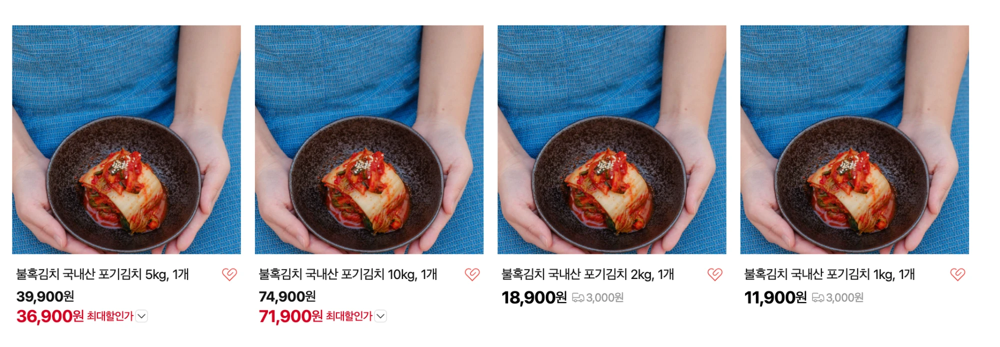

# 현재 가격 기록 (2026-10-30 스토어 화면)

| 상품 | 판매가 | 화면 표시 | 배송비 |
|---|---|---|---|
| 1kg | 11,900원 | 할인 표시 없음 | 3,000원 |
| 2kg | 18,900원 | 할인 표시 없음 | 3,000원 |
| 5kg | 39,900원 | 최대할인가 36,900원 (3,000원 차이) | 표시 없음(무료로 보임) |
| 10kg | 74,900원 | 최대할인가 71,900원 (3,000원 차이) | 표시 없음(무료로 보임) |

- 즉시할인이 아니라 쿠폰으로 보인다. 즉시할인이면 판매가에 취소선이 붙고 할인가가 바로 보인다. "최대할인가"는 받을 수 있는 쿠폰까지 적용한 가격이다.
- 할인 금액이 3,000원으로 같고 5kg·10kg에만 붙는다. 그래서 "일정 금액 이상 주문 시 3,000원" 같은 최소 주문 금액 조건이 걸린 쿠폰으로 보인다. 18,900원인 2kg에는 안 붙는다.
- 핸드오프에 적은 계획(즉시할인 10%, 12/15까지)은 아직 반영되지 않았다.

## "최대할인가"가 붙었다 떨어졌다 하는 이유 (점검 순서)

최대할인가는 보는 사람마다 받을 수 있는 쿠폰을 계산해서 붙는다. 그래서 같은 상품도 화면에 따라 붙기도 하고 안 붙기도 한다.

1. **로그인 상태와 계정:** 로그인 여부와 계정에 따라 다르다. 이미 쿠폰을 받았거나 써 버린 계정, 스토어찜 쿠폰처럼 조건이 있는 쿠폰을 받을 수 없는 계정에는 붙지 않는다.
2. **쿠폰 발급 기간과 수량:** 혜택관리에서 쿠폰의 발급 기간, 사용 기간, 발급 수량을 확인한다. 기간이 끝났거나 수량이 다 떨어지면 사라진다.
3. **쿠폰 대상 상품:** 쿠폰이 "스토어 전체"인지 "일부 상품"인지 확인한다. 최소 주문 금액이 있는지도 같이 본다.
4. **화면 반영 지연:** 쿠폰을 바꾼 뒤에는 검색 결과와 목록 화면에 반영될 때까지 시간이 걸린다.

할 일
- [ ] 스마트스토어센터 → 혜택관리 → 혜택 조회에서 지금 걸린 쿠폰의 종류, 금액, 최소 주문 금액, 기간, 수량, 대상 상품을 이 문서에 적는다.
- [ ] 할인 계획(즉시할인 10%와 스토어찜 쿠폰 1,000원)과 지금 쿠폰을 둘 다 유지할지 팀에서 정한다. 둘 다 걸면 "최대할인가"는 둘을 합친 값이 된다.
- [ ] 소용량 2개로 합친 뒤에는 2kg 혼자 사면 배송비 3,000원이 붙는다. 30,000원 이상 무료 조건이 생기면 2kg 2개(37,800원)부터 무료가 된다.
